

# VOTEX

### Cloud-Native DevSecOps Platform on AWS EKS

**A real-time voting application engineered to demonstrate secure CI/CD, infrastructure as code, Kubernetes operations, observability, and resilience.**

[**Screenshot Gallery**](#screenshot-gallery) · [**Explore Evidence**](proofs/README.md) · [**Jenkins Pipeline**](jenkins/Jenkinsfile) · [**Terraform Infrastructure**](terraform/) · [**Helm Chart**](k8s/helm/votex/) · [**Operations Runbooks**](terraform/README.md)

> [!IMPORTANT]
> **Completed AWS demonstration — intentionally offline.** Votex was deployed and tested on an actual Amazon EKS cluster in **`eu-north-1` (Stockholm)**. The cloud infrastructure was subsequently decommissioned to avoid ongoing costs. This repository retains implementation, test outputs, tool reports, and **26 captured screenshots**; the URLs shown in historical evidence are **not live demo links**. [View teardown verification](proofs/aws/aws-teardown-verification.txt).

## At a Glance

| **Secure delivery** | **Load-test validation** | **Database recovery** | **Self-healing verification** |
| :---: | :---: | :---: | :---: |
| **9 / 9 stages passed** | **903 / 903 checks passed** | **10 / 10 rows restored** | **5s Worker · 7s Redis** |
| [Jenkins Build #16](proofs/ci-cd/jenkins-build-16-pipeline.json) | [129 votes · HTTP p95 272.7ms](proofs/operations/k6-load-test-summary.txt) | [Isolated PostgreSQL restore](proofs/operations/ansible-disaster-recovery-log.txt) | [Observed pod recovery](proofs/operations/chaos-resilience-test-log.txt) |

### Application Preview

| Voting application | Real-time results dashboard |
| :---: | :---: |
| [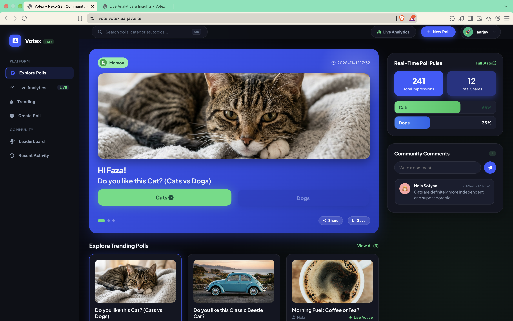](https://github.com/itsme-aarjav/votex/blob/main/proofs/screenshots/application/vote-application.png) | [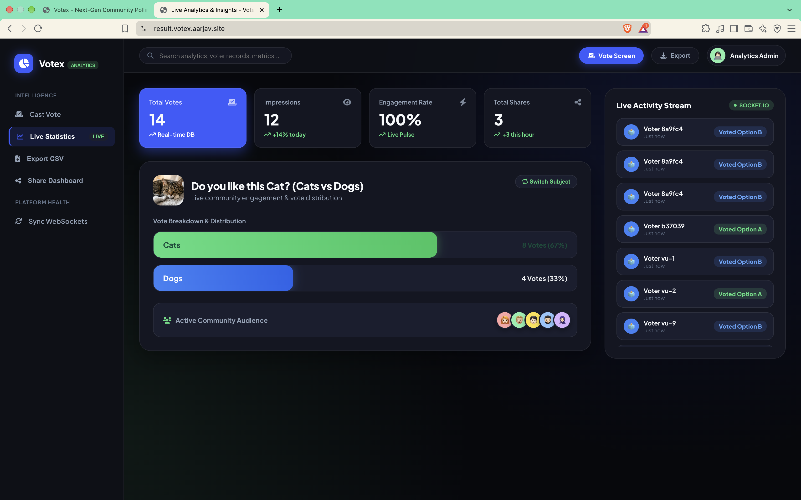](https://github.com/itsme-aarjav/votex/blob/main/proofs/screenshots/application/result-analytics-dashboard.png) |
| **Flask** — polls, users, voting, authentication | **Node.js + Socket.IO** — live PostgreSQL-backed analytics |

**Quick proof:** [Jenkins Stage View](https://github.com/itsme-aarjav/votex/blob/main/proofs/screenshots/ci-cd/jenkins-pipeline-stageview.png) · [SonarQube Quality Gate](https://github.com/itsme-aarjav/votex/blob/main/proofs/screenshots/security/sonarqube-quality-gate.png) · [Grafana Metrics](https://github.com/itsme-aarjav/votex/blob/main/proofs/screenshots/observability/grafana-cluster-cpu-memory.png) · [Loki Logs](https://github.com/itsme-aarjav/votex/blob/main/proofs/screenshots/observability/grafana-loki-logs.png) · [AWS X-Ray](https://github.com/itsme-aarjav/votex/blob/main/proofs/screenshots/observability/aws-xray-service-map.png)

## Project Overview

**Votex is an end-to-end DevSecOps engineering showcase**, using a distributed polling application as the workload. It covers the full lifecycle: provision AWS infrastructure with Terraform, build and scan three application images, deploy to Kubernetes with Helm, monitor metrics/logs/traces, validate failure recovery, and safely tear down the demo environment.

The emphasis is on **delivery engineering and operational proof**, rather than simply hosting a web application:

- **Security-gated CI/CD:** SonarQube Quality Gate, Trivy filesystem/image scans, and OWASP ZAP baseline DAST before image publishing and EKS delivery.
- **Cloud infrastructure as code:** Modular VPC/EKS/Lambda Terraform, restricted EKS API access, IRSA, EBS gp3 volumes, and encrypted S3 remote state with native locking.
- **End-to-end observability:** Prometheus/Grafana metrics, Alloy/Loki logs, OpenTelemetry/X-Ray traces, and AWS Lambda/CloudWatch synthetic checks.
- **Operational reliability:** Health probes, HPA configuration, controlled chaos tests, Ansible verification and PostgreSQL backup/restore, Helm rollback evidence, and guarded teardown.

## Technology Stack

<b>Cloud, infrastructure & containers</b>

 

**AWS services:** EKS, EC2, VPC, ALB, EBS gp3, S3, IAM/IRSA, Route 53, ACM, Lambda, EventBridge, CloudWatch, and X-Ray.

<b>CI/CD, automation & security</b>

 

<b>Metrics, logs & distributed tracing</b>

 

<b>Application, data & testing</b>

 

## Architecture

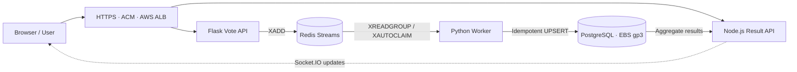

| Component | Responsibility | Source |
| --- | --- | --- |
| **Vote API** | Polls, login/registration, voting, CSRF handling, request rate limiting, Redis event publishing | [`votex/vote/`](votex/vote/) |
| **Redis Streams** | Buffers events and decouples vote acceptance from database persistence | [`votex/worker/app.py`](votex/worker/app.py) |
| **Worker** | Consumer groups, pending-message reclaim, idempotent PostgreSQL upsert | [`votex/worker/`](votex/worker/) |
| **PostgreSQL** | Durable poll, user, vote, comment, bookmark, and activity data | [`votex/db/init.sql`](votex/db/init.sql) |
| **Result service** | Database-backed result queries, live Socket.IO broadcasts, CSV export | [`votex/result/`](votex/result/) |

The services run as separate Kubernetes workloads, with internal ClusterIP services for database and Redis, application health probes, and persistent storage.

## Jenkins DevSecOps Pipeline

A declarative [`Jenkinsfile`](jenkins/Jenkinsfile) runs on **ephemeral Kubernetes build agents**. Candidate images must pass the configured scan gates **before Docker Hub publication and Helm delivery**. The recorded demo build is **[#16: SUCCESS](proofs/ci-cd/jenkins-build-16-pipeline.json)**.

**Delivery path:** `GitHub main` → smoke validation → SAST & filesystem scan → Docker build → image scan & DAST → Docker Hub → Helm rollout & Ansible verification.

| Stage | What is verified |
| :---: | --- |
| **01 · Checkout** | SCM checkout and commit-specific release tagging |
| **02 · Smoke tests** | Python Vote/Worker and Node.js Result validation |
| **03 · SonarQube** | Static analysis and blocking Quality Gate |
| **04 · Trivy FS** | HIGH/CRITICAL dependency vulnerability policy |
| **05 · Build** | Three versioned `linux/amd64` Docker images |
| **06 · Trivy images** | CRITICAL vulnerability blocking policy for candidate images |
| **07 · OWASP ZAP** | Baseline DAST against an isolated candidate Vote environment |
| **08 · Publish** | Approved images pushed to Docker Hub |
| **09 · Deploy** | Helm rollout, post-deploy Ansible checks, rollback handling |

**Security gate evidence** — historical scanner outputs from the successful demo:

| Tool | Observed result | Proof |
| --- | --- | --- |
| **SonarQube** | Quality Gate **passed**; also reported 22 security hotspots, 9 bugs, 111 code smells, and **0.0% coverage** | [Quality Gate](https://github.com/itsme-aarjav/votex/blob/main/proofs/screenshots/security/sonarqube-quality-gate.png) · [Measures](https://github.com/itsme-aarjav/votex/blob/main/proofs/screenshots/security/sonarqube-overall-measures.png) |
| **Trivy filesystem** | 0 HIGH / 0 CRITICAL findings under the chosen policy | [Console output](proofs/security/trivy-fs-scan-console.txt) |
| **Trivy images** | 0 HIGH / 0 CRITICAL findings in the selected recorded scans; pipeline blocks CRITICAL findings | [Vote](proofs/security/trivy-image-vote-scan.txt) · [Result](proofs/security/trivy-image-result-scan.txt) · [Worker](proofs/security/trivy-image-worker-scan.txt) |
| **OWASP ZAP** | 0 High/Critical; **3 Medium, 6 Low, 2 Informational** alert types (non-blocking results retained) | [HTML report](proofs/security/zap-report.html) · [JSON report](proofs/security/zap-report.json) |

> **Security scope:** Passing gates does not mean zero vulnerabilities or full application test coverage. Scan thresholds and exceptions are defined in [`security/`](security/), and the SonarQube findings remain visible instead of being hidden.

## AWS Infrastructure as Code

Provisioning is split into reusable Terraform modules and an independent remote-state bootstrap.

| Area | Implementation |
| --- | --- |
| **Networking** | `10.0.0.0/16` VPC; 2 public + 2 private subnets across 2 AZs; Internet Gateway and 1 NAT Gateway |
| **Kubernetes** | EKS managed node group with **2 × `m7i-flex.large`**, nodes in private subnets |
| **Ingress** | Shared AWS ALB, ACM TLS, Route 53 host routing for apps and operational dashboards |
| **Storage** | EBS CSI with gp3 PVCs for PostgreSQL, Redis, Jenkins, SonarQube, and monitoring data |
| **Security / access** | EKS API CIDR allowlist, IAM roles, and scoped IRSA roles for controllers and X-Ray exporter |
| **State management** | Encrypted, versioned S3 backend; Terraform-native `.tflock` locking (no DynamoDB) |
| **Availability checks** | EventBridge-triggered Lambda, CloudWatch custom metrics, 3 health alarms |

**Implementation:** [`terraform/modules/vpc`](terraform/modules/vpc/) · [`terraform/modules/eks`](terraform/modules/eks/) · [`terraform/modules/lambda`](terraform/modules/lambda/) · [State bootstrap](terraform/bootstrap/) · [Terraform runbook](terraform/README.md)

## Observability & Operations

| Signal | Data flow | Recorded proof |
| --- | --- | --- |
| **Metrics** | Kubernetes / app metrics → Prometheus → Grafana | [CPU and memory](https://github.com/itsme-aarjav/votex/blob/main/proofs/screenshots/observability/grafana-cluster-cpu-memory.png) · [Pods](https://github.com/itsme-aarjav/votex/blob/main/proofs/screenshots/observability/grafana-pod-cpu-usage.png) |
| **Logs** | Container logs → Grafana Alloy → Loki → Grafana | [Loki explorer](https://github.com/itsme-aarjav/votex/blob/main/proofs/screenshots/observability/grafana-loki-logs.png) |
| **Traces** | OTel SDK → Collector → AWS X-Ray, using IRSA | [X-Ray service map](https://github.com/itsme-aarjav/votex/blob/main/proofs/screenshots/observability/aws-xray-service-map.png) |
| **Synthetic checks** | EventBridge (5 min) → Lambda → CloudWatch | [Alarms overview](https://github.com/itsme-aarjav/votex/blob/main/proofs/screenshots/aws/aws-cloudwatch-alarms-overview.png) · [Lambda metrics](https://github.com/itsme-aarjav/votex/blob/main/proofs/screenshots/aws/aws-lambda-monitoring-metrics.png) |

**Reliability experiments:**

- **k6 baseline:** 903/903 checks passed, 129 successful votes, **HTTP request p95 272.7ms**, 0% HTTP request failures. This validates a short baseline run, **not large-scale capacity**. [Test script](tests/load/load-test.js) · [Result](proofs/operations/k6-load-test-summary.txt)
- **Chaos recovery:** Forced Worker and Redis pod replacement; observed readiness recovery in **5s** and **7s**, respectively. [Script](tests/resilience/chaos-test.sh) · [Log](proofs/operations/chaos-resilience-test-log.txt)
- **PostgreSQL recovery:** Ansible `pg_dump` + isolated `pg_restore`; verified **10/10** source/restored rows without touching the primary database. [Playbook](ansible/backup_restore_verify.yml) · [Log](proofs/operations/ansible-disaster-recovery-log.txt)
- **Rollbacks:** Helm release history preserves revisions 1–14 and recovery events. [History](proofs/operations/helm-release-history.txt)
- **HPA:** CPU-based autoscaling configured with active metrics; the baseline load **did not trigger a replica scale-out**. [Evidence](proofs/operations/kubernetes-hpa.txt)

## Deployment & Teardown

> [!CAUTION]
> The original AWS resources, including the Terraform state bucket, were **removed after the completed demonstration**. Deployment commands below describe project capabilities; they are **not** one-click instructions for an existing live environment. A new deployment requires a fresh state bootstrap, valid AWS permissions, configuration, and explicit approval of billable resources.

| Helper | Purpose |
| --- | --- |
| `bash ops/deploy.sh --offline` | Offline Terraform formatting/validation without AWS changes |
| `bash ops/deploy.sh --plan` | AWS-backed plan after backend bootstrap and initialization |
| `bash ops/deploy.sh --full` | Preflight-checked, human-approved full deployment workflow |
| `bash ops/dashboard.sh` | Read-only platform/service dashboard access summary |
| `bash ops/destroy.sh` | Guarded platform teardown while preserving ordinary S3 state |
| `bash ops/destroy.sh --recover-partial` | Recovery path for partially provisioned infrastructure |

**Historical lifecycle:** S3 bootstrap → Terraform VPC/EKS → Helm services and tools → security-gated Jenkins release → monitoring and resilience tests → evidence capture → authorized teardown. See [deployment scripts](ops/), [Terraform runbook](terraform/README.md), and [decommission audit](proofs/aws/aws-teardown-verification.txt).

## Repository Structure

| Folder | What's inside |
| --- | --- |
| [`votex/`](votex/) | Flask Vote API, Node.js Result UI, Python Worker, PostgreSQL schema, frontend assets |
| [`terraform/`](terraform/) | VPC/EKS/Lambda modules, backend bootstrap, configuration, and runbooks |
| [`k8s/`](k8s/) | Helm chart, storage, ingress, HPA, and monitoring stack |
| [`jenkins/`](jenkins/) | Nine-stage CI/CD pipeline and Kubernetes Jenkins manifests |
| [`security/`](security/) + [`sonarqube/`](sonarqube/) | Trivy, OWASP ZAP, SonarQube configuration |
| [`ansible/`](ansible/) + [`lambda/`](lambda/) | Deployment verification, database restore verification, synthetic checks |
| [`tests/`](tests/) + [`docker/`](docker/) | k6, chaos/operations tests, isolated Compose candidate environment |
| [`ops/`](ops/) | Deploy, inspect dashboards, and destroy orchestration |
| [`proofs/`](proofs/) | Historical execution logs, security artifacts, and captured screenshots |

## Evidence Portfolio

All artifacts below reflect the completed historical AWS demonstration, **not continuously running production infrastructure**.

| Evidence | Files | What to inspect |
| --- | :---: | --- |
| [Application](proofs/screenshots/application/) | **2** | Voting portal and result dashboard |
| [CI/CD](proofs/screenshots/ci-cd/) | **3** | Jenkins pipeline and Trivy/ZAP artifacts |
| [Security](proofs/screenshots/security/) | **5** | SonarQube Quality Gate and code-quality measures |
| [Observability](proofs/screenshots/observability/) | **7** | Grafana, Loki, pod metrics, AWS X-Ray |
| [AWS](proofs/screenshots/aws/) | **9** | EKS, VPC, Lambda, and CloudWatch |

### Deployment & Operations — Visual Proof Gallery

The following screenshots were captured during the completed AWS demonstration. **Click any image to open it at full resolution.** The application screenshots are already shown in the [Application Preview](#application-preview) above.

**CI/CD & security gates**

| Jenkins pipeline — successful Build #16 | SonarQube — Quality Gate |
| :---: | :---: |
| [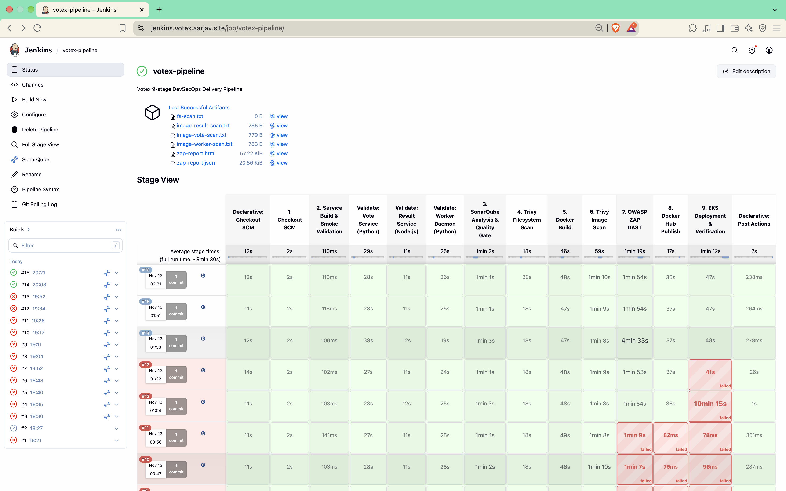](https://github.com/itsme-aarjav/votex/blob/main/proofs/screenshots/ci-cd/jenkins-pipeline-stageview.png) | [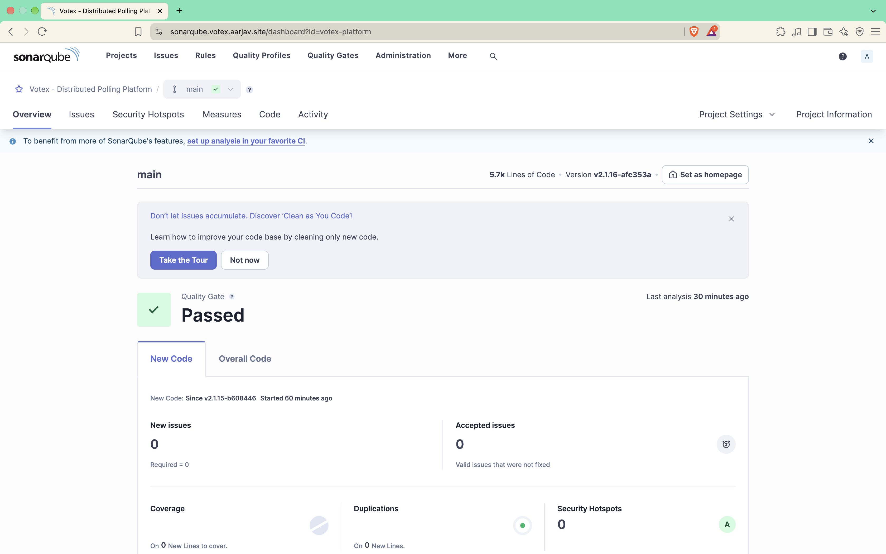](https://github.com/itsme-aarjav/votex/blob/main/proofs/screenshots/security/sonarqube-quality-gate.png) |
| **Nine security-gated delivery stages** | **Static analysis and recorded gate result** |

| OWASP ZAP — archived DAST artifacts | AWS EKS — deployed cluster |
| :---: | :---: |
| [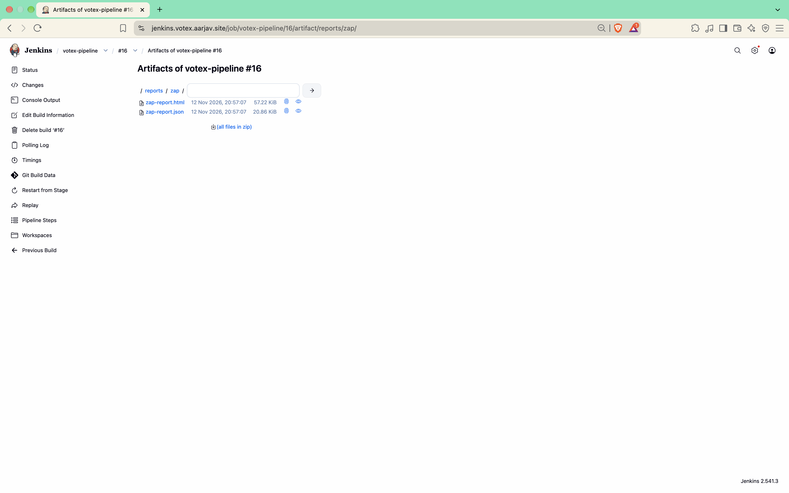](https://github.com/itsme-aarjav/votex/blob/main/proofs/screenshots/ci-cd/jenkins-zap-artifacts.png) | [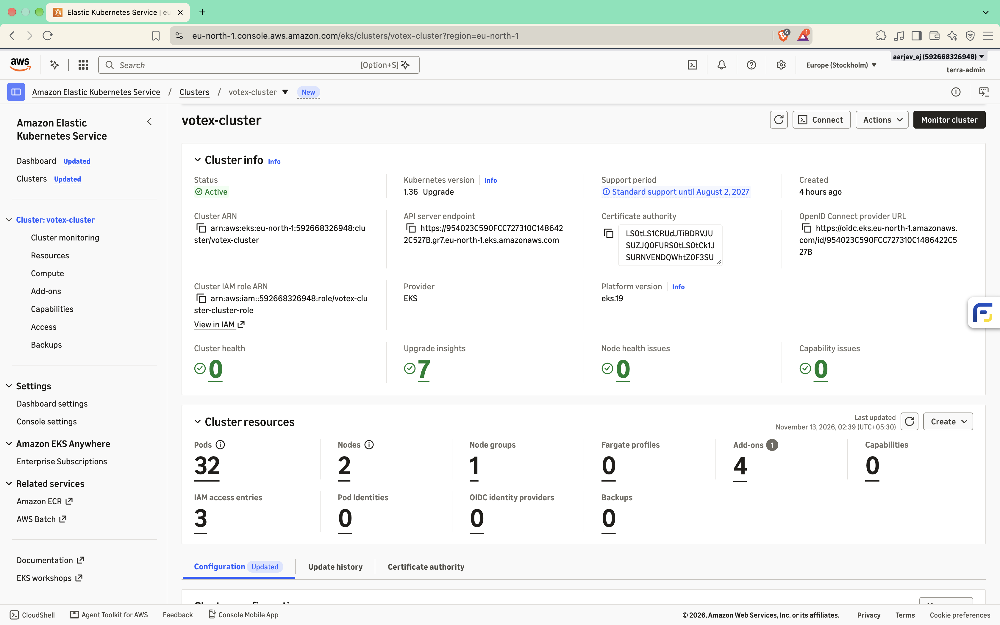](https://github.com/itsme-aarjav/votex/blob/main/proofs/screenshots/aws/aws-eks-cluster-overview.png) |
| **Security reports retained in Jenkins** | **Real AWS Kubernetes demonstration** |

**Metrics, logs, tracing & availability**

| Grafana — cluster CPU & memory | Grafana Loki — centralized logs |
| :---: | :---: |
| [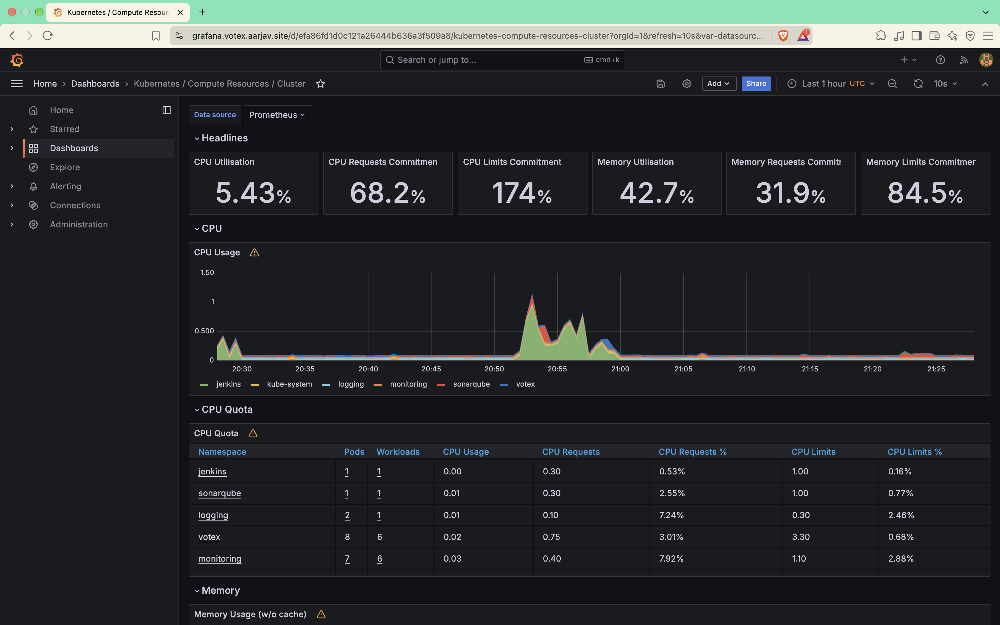](https://github.com/itsme-aarjav/votex/blob/main/proofs/screenshots/observability/grafana-cluster-cpu-memory.png) | [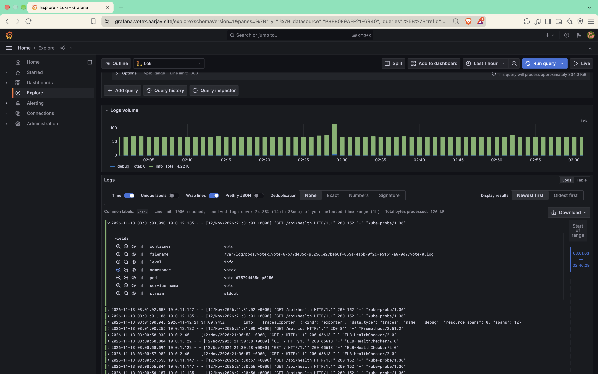](https://github.com/itsme-aarjav/votex/blob/main/proofs/screenshots/observability/grafana-loki-logs.png) |
| **Kubernetes resource visibility** | **Container log exploration** |

| AWS X-Ray — service map | CloudWatch — synthetic health alarms |
| :---: | :---: |
| [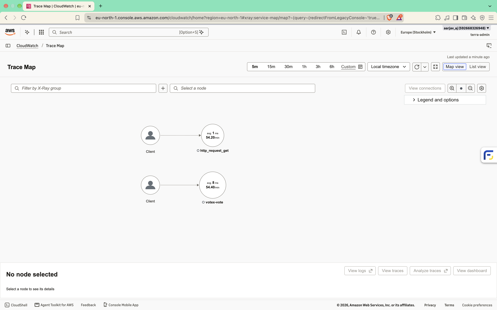](https://github.com/itsme-aarjav/votex/blob/main/proofs/screenshots/observability/aws-xray-service-map.png) | [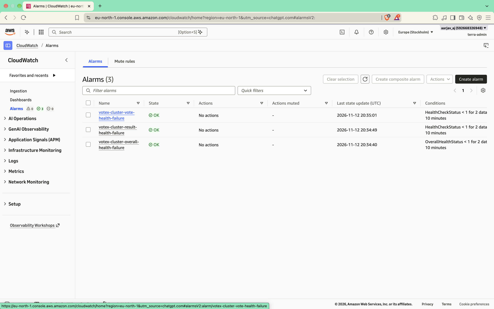](https://github.com/itsme-aarjav/votex/blob/main/proofs/screenshots/aws/aws-cloudwatch-alarms-overview.png) |
| **OpenTelemetry trace visualization** | **Vote, Result & Overall health monitoring** |

### Remaining Screenshots — Direct Links

**10 of 26 screenshots are previewed in this README** (2 application + 8 engineering screenshots). The **remaining 16** are linked individually below so every captured visual is accessible without making the page unnecessarily long.

<b>CI/CD · 1 additional screenshot</b>

- [Jenkins — Trivy security scan artifacts](https://github.com/itsme-aarjav/votex/blob/main/proofs/screenshots/ci-cd/jenkins-trivy-artifacts.png)

<b>SonarQube · 4 additional screenshots</b>

- [SonarQube — activity timeline](https://github.com/itsme-aarjav/votex/blob/main/proofs/screenshots/security/sonarqube-activity-timeline.png)
- [SonarQube — code metrics](https://github.com/itsme-aarjav/votex/blob/main/proofs/screenshots/security/sonarqube-code-metrics.png)
- [SonarQube — overall measures and findings](https://github.com/itsme-aarjav/votex/blob/main/proofs/screenshots/security/sonarqube-overall-measures.png)
- [SonarQube — analyzed projects list](https://github.com/itsme-aarjav/votex/blob/main/proofs/screenshots/security/sonarqube-projects-list.png)

<b>Grafana · 4 additional screenshots</b>

- [Grafana — cluster networking](https://github.com/itsme-aarjav/votex/blob/main/proofs/screenshots/observability/grafana-cluster-network.png)
- [Grafana — node-level metrics](https://github.com/itsme-aarjav/votex/blob/main/proofs/screenshots/observability/grafana-node-metrics.png)
- [Grafana — pod CPU usage](https://github.com/itsme-aarjav/votex/blob/main/proofs/screenshots/observability/grafana-pod-cpu-usage.png)
- [Grafana — pod memory usage](https://github.com/itsme-aarjav/votex/blob/main/proofs/screenshots/observability/grafana-pod-memory-usage.png)

<b>AWS Console · 7 additional screenshots</b>

- [Amazon EKS — cluster resources](https://github.com/itsme-aarjav/votex/blob/main/proofs/screenshots/aws/aws-eks-cluster-resources.png)
- [Amazon VPC — network configuration](https://github.com/itsme-aarjav/votex/blob/main/proofs/screenshots/aws/aws-vpc-configuration.png)
- [AWS Lambda — synthetic health-check function](https://github.com/itsme-aarjav/votex/blob/main/proofs/screenshots/aws/aws-lambda-synthetic-function.png)
- [AWS Lambda — monitoring metrics](https://github.com/itsme-aarjav/votex/blob/main/proofs/screenshots/aws/aws-lambda-monitoring-metrics.png)
- [CloudWatch — Vote service health alarm](https://github.com/itsme-aarjav/votex/blob/main/proofs/screenshots/aws/aws-cloudwatch-alarm-vote-health.png)
- [CloudWatch — Result service health alarm](https://github.com/itsme-aarjav/votex/blob/main/proofs/screenshots/aws/aws-cloudwatch-alarm-result-health.png)
- [CloudWatch — Overall service health alarm](https://github.com/itsme-aarjav/votex/blob/main/proofs/screenshots/aws/aws-cloudwatch-alarm-overall-health.png)

**Evidence index:** [Full proof catalog](proofs/README.md) · [All screenshots](proofs/screenshots/README.md) · [Security reports](proofs/security/) · [Operations logs](proofs/operations/) · [CI/CD output](proofs/ci-cd/) · [AWS teardown](proofs/aws/aws-teardown-verification.txt)

## Engineering Trade-offs & Limitations

The project demonstrates practical DevSecOps implementation and **keeps its limitations explicit**:

1. **Security posture:** SonarQube Quality Gate passed, but reported 22 hotspots, 9 bugs, 111 smells, and 0.0% recorded coverage. ZAP also reported non-blocking findings.
2. **Load and scaling:** Baseline k6 validation passed; enterprise-scale throughput and actual HPA replica scale-out were **not** demonstrated.
3. **Database backup:** In-cluster logical backup and isolated restore worked. Automated **off-cluster S3 archival was not configured** for the captured DR run.
4. **Container hardening:** Worker runs as non-root with dropped capabilities. Vote and Result use root to bind port 80 and are not presented as universally hardened.
5. **Monitoring evidence:** Grafana dashboards were captured; no dedicated native Prometheus `/targets` screenshot was preserved.
6. **Runtime status:** AWS demo was intentionally decommissioned after validation; this is an evidence-backed portfolio project, **not an always-on production service**.

---

**Built to demonstrate the complete DevSecOps lifecycle — from code commit to verified cloud operations.**

