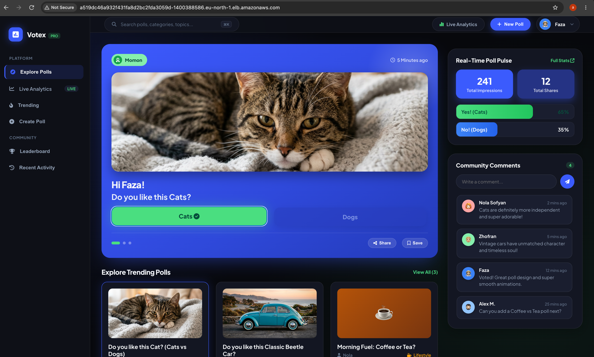
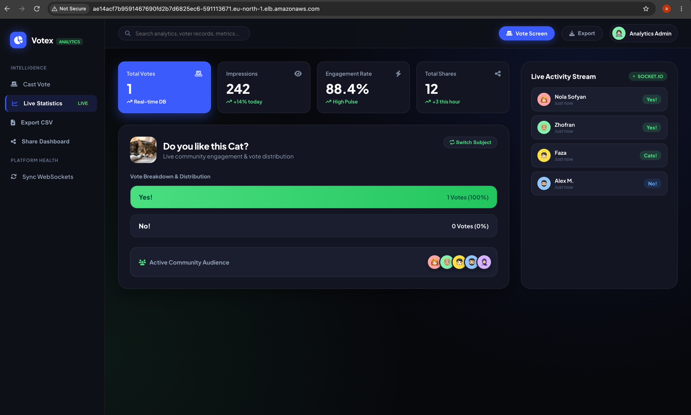
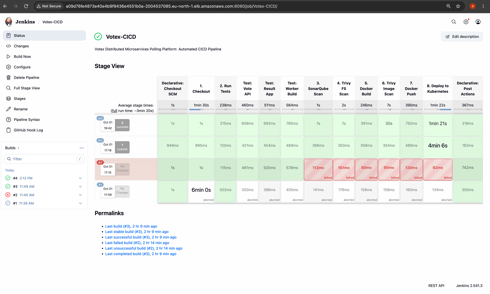
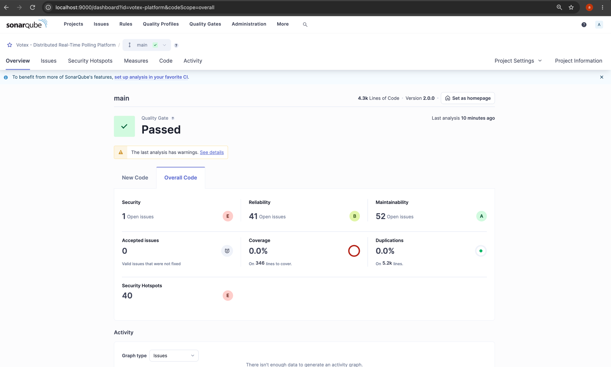
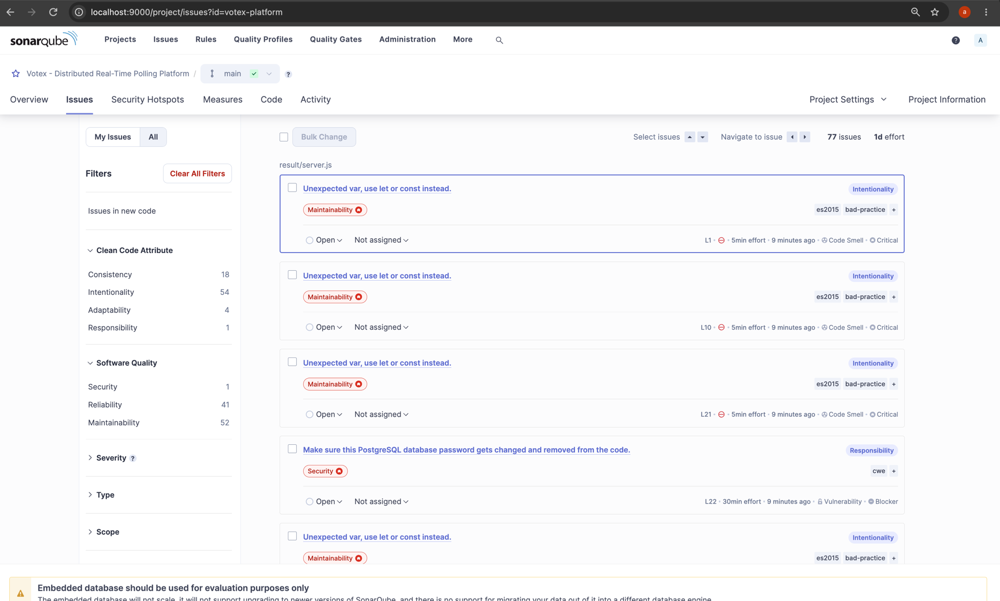
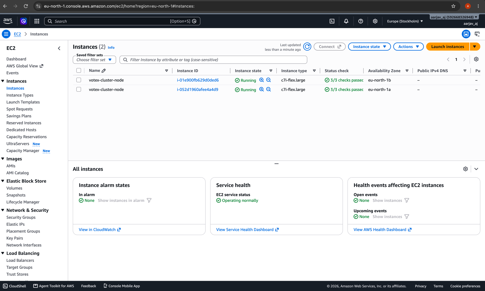

# Votex — Cloud-Native Distributed Microservices on AWS EKS

Votex is an enterprise 5-tier microservices polling and real-time analytics platform provisioned on Amazon EKS using modular Terraform and Helm 3. It demonstrates production-grade DevSecOps engineering with an automated 9-stage Jenkins declarative pipeline, SonarQube static code analysis, Trivy vulnerability scanning, OWASP ZAP dynamic application security testing, Prometheus/Grafana metrics, Grafana Alloy & Loki log aggregation, OpenTelemetry distributed tracing with AWS X-Ray, non-destructive Ansible PostgreSQL disaster recovery verification, and AWS Lambda external synthetic monitoring.

---

## 1. Application Interfaces & Architecture

The application comprises a user-facing voting portal, an in-memory stream buffer, an asynchronous persistence worker daemon, and a live analytics dashboard:

| Vote Microservice (Python / Flask) | Result Analytics (Node.js / Socket.IO) |
| :---: | :---: |
|  |  |

### Microservices Data Flow

```
                      [ Client Web Traffic ]
                                │
                                ▼
            [ AWS Application Load Balancer Ingress ]
            (SSL / TLS Port 443 ── Shared ALB Group)
                                │
        ┌───────────────────────┴───────────────────────┐
        ▼                                               ▼
  Vote Service                                   Result Service
  (Python Flask / Gunicorn)                   (Node.js + Socket.IO)
        │                                               ▲
        ▼ (XADD / Redis Streams)                        │ (Real-Time WebSocket Updates)
 Redis In-Memory Queue                                  │
        │                                               │
        ▼ (XREADGROUP / XAUTOCLAIM)                     │
  Worker Service                                        │
  (Python Daemon)                                       │
        │                                               │
        ▼ (Idempotent UPSERT Transactions)              │
  PostgreSQL Relational DB (AWS EBS gp3 PVC) ───────────┘
```

1. **Vote Submission**: Users submit votes through the Python Flask microservice. Requests are authenticated, CSRF-validated, rate-limited, and injected with W3C distributed trace context (`traceparent`).
2. **Buffering**: Submissions are appended to an in-memory Redis stream (`votes_stream`) using consumer groups, isolating web traffic spikes from database write latencies.
3. **Asynchronous Persistence**: A Python worker daemon consumes votes using Redis consumer groups (`XREADGROUP` and `XAUTOCLAIM`), ensuring at-least-once processing and zero message loss across pod restarts, executing idempotent SQL UPSERT transactions into PostgreSQL.
4. **Real-Time Analytics**: The Node.js Express service queries PostgreSQL, aggregates multi-poll voting analytics, and broadcasts live tally updates to connected clients via WebSockets (`Socket.IO`).

---

## 2. DevSecOps CI/CD Pipeline (Jenkins)

Every commit to `main` executes an automated, 9-stage declarative Jenkins pipeline running on ephemeral Kubernetes agents inside the EKS cluster:



### The 9 Pipeline Stages & Security Gates

```
[1. Checkout] ──> [2. Smoke Validation] ──> [3. SonarQube SAST] ──> [4. Trivy Filesystem]
                                                                            │
┌───────────────────────────────────────────────────────────────────────────┘
▼
[5. Docker Build] ──> [6. Trivy Image Scan] ──> [7. OWASP ZAP DAST] ──> [8. Docker Hub Publish]
                                                                                │
┌───────────────────────────────────────────────────────────────────────────────┘
▼
[9. EKS Helm Deployment & Ansible Verification]
```

| Stage # | Stage Name | Tooling | Quality & Security Gate Enforced |
| :---: | :--- | :--- | :--- |
| **1** | **Checkout SCM** | Git Plugin | Clones `origin/main`, resolves short commit SHA, creates deterministic release candidate tag `v2.1.${BUILD_NUMBER}-${SHA}`. |
| **2** | **Service Build & Smoke Validation** | Python 3.11, Node.js 18, pip, npm | Compiles AST bytecode (`py_compile`), verifies dependencies, launches services in background, validates `/api/health` probes, and cleanly terminates processes. Works out-of-the-box on fresh clones without local test dependencies. |
| **3** | **SonarQube Analysis & Quality Gate** | SonarScanner CLI, SonarQube Server | Static Application Security Testing (SAST). Scans application code for security hotspots, bugs, and code smells. Enforces a strict Quality Gate threshold via `waitForQualityGate()`. |
| **4** | **Trivy Filesystem Scan** | Trivy CLI | Shifts security left by scanning the repository filesystem and third-party dependencies. Blocks pipeline on unpatched `HIGH` or `CRITICAL` vulnerabilities. |
| **5** | **Docker Build** | Docker CLI, Buildx | Multi-stage `linux/amd64` builds producing optimized, minimal production containers for Vote, Result, and Worker microservices. |
| **6** | **Trivy Image Scan** | Trivy CLI | Container vulnerability scanner. Evaluates OS base layers and binary packages in built release candidate images before publication. Blocks on `CRITICAL` CVEs. |
| **7** | **OWASP ZAP DAST** | OWASP ZAP container | Dynamic Application Security Testing (DAST). Boots candidate release in an isolated Docker network and performs active baseline security scans against live HTTP endpoints. |
| **8** | **Docker Hub Publish** | Docker CLI, Credential Store | Authenticates and publishes verified immutable release tags (`v2.1.${BUILD_NUMBER}-${SHA}`) to Docker Hub (`aarjavjainn`). |
| **9** | **EKS Deployment & Verification** | Helm 3, Kubectl, Ansible | Deploys release Helm chart to EKS cluster with atomic rollback (`--atomic`), verifies deployment rollout status, and runs Ansible post-deployment health verification. |

> [!NOTE]
> Detailed application unit and integration suites (`votex/tests/`, `votex/result/tests/`) remain local-only on the developer's workstation for rapid iteration. CI Stage 2 executes standalone syntax, import, and process smoke checks, ensuring deterministic, hermetic pipeline builds on clean repository checkouts.

### Code Quality & Security Evidence (SonarQube)

| Quality Gate Overview | Code Quality & Vulnerability Breakdown |
| :---: | :---: |
|  |  |

---

## 3. Dedicated Responsibilities of DevOps Tooling

Every tool in the Votex platform has a distinct, necessary responsibility without redundant overlaps:

### 1. AWS Lambda — External Synthetic Uptime Monitoring
- **Role**: Validates user-facing service availability independently of Kubernetes.
- **Why it is distinct**: Kubernetes liveness probes run *inside* the cluster node network. If the worker nodes lose network connectivity, CoreDNS crashes, or the AWS Application Load Balancer fails, internal probes report false positives or cannot alert. AWS Lambda runs outside the VPC and is triggered every 5 minutes by Amazon EventBridge to test public HTTPS endpoints, recording availability and latency to CloudWatch alarms.

### 2. Ansible — PostgreSQL Disaster Recovery & Restore Verification
- **Role**: Automated logical backup creation and non-destructive recovery verification.
- **Why it is distinct**: While Helm deploys workloads and Terraform provisions infrastructure, Ansible manages database disaster recovery. `ansible/backup_restore_verify.yml` connects to the PostgreSQL pod, executes `pg_dump`, restores the dump into an isolated temporary database (`votex_verify_<timestamp>`), validates table schemas and row counts, safely drops the temporary database, and retains evidence without ever overwriting live production data.

### 3. Load Testing (`tests/load/load-test.js`) — Concurrency & Autoscaling
- **Role**: Synthetic traffic generation using k6.
- **Why it is distinct**: Simulates concurrent user voting traffic across configurable profiles (`baseline`, `stress`, `spike`) with distinct virtual user identities (`voter_id` cookies). Measures throughput, failure rates, and p95 latency. Respects CSRF tokens and rate limits to demonstrate Kubernetes Horizontal Pod Autoscaling (HPA) without weakening application security.

### 4. Chaos Resilience Testing (`tests/resilience/chaos-test.sh`) — Self-Healing Proof
- **Role**: Controlled failure injection and recovery validation.
- **Why it is distinct**: Injects controlled pod terminations against the Worker daemon and Redis queue. Observes ReplicaSet reconciliation and measures recovery time in seconds. Verifies persistent volume data integrity and pod `Ready=True` conditions with explicit safety gates (`--dry-run` and `--confirm`).

### 5. Proper Observability Matrix (Logs vs. Metrics vs. Traces)
The platform avoids duplicate pipelines by maintaining strict boundaries across observability pillars:

| Observability Pillar | Primary Tool | Collection Agent | Storage & Backend | Visualization |
| :--- | :--- | :--- | :--- | :--- |
| **Metrics** | Prometheus | Kube-State-Metrics, Node-Exporter | Prometheus TSDB (gp3 PVC) | Grafana |
| **Logs** | Loki | Grafana Alloy (daemonset log scraper) | Loki Single-Binary (gp3 PVC) | Grafana (Loki Datasource) |
| **Traces** | OpenTelemetry | OpenTelemetry Collector Contrib | AWS X-Ray (via OTel IRSA exporter) | AWS X-Ray Console |

- **Metrics (Prometheus & Grafana)**: Numeric counters, gauges, and rates measuring CPU, memory, container restarts, and HPA scaling.
- **Logs (Grafana Alloy & Loki)**: Structured application and container logs. Alloy parses container runtimes and ships log streams directly to Loki without heavy distributed dependencies or deprecated Promtail.
- **Traces (OpenTelemetry & AWS X-Ray)**: Distributed end-to-end transaction paths. Python microservices (Vote and Worker) use the OpenTelemetry SDK with `AwsXRayIdGenerator` to trace requests across HTTP, Redis Streams, and PostgreSQL. Traces are exported via OTLP gRPC to the OpenTelemetry Collector and forwarded to AWS X-Ray.

---

## 4. AWS Cloud Infrastructure (Option B — `eu-north-1`)

All cloud infrastructure is provisioned through modular Terraform in `eu-north-1` (Stockholm):



- **Isolated Custom VPC (`10.0.0.0/16`)**:
  - **2 Public Subnets** (`10.0.1.0/24`, `10.0.2.0/24`): Host the NAT Gateway and internet-facing Application Load Balancer.
  - **2 Private Subnets** (`10.0.11.0/24`, `10.0.12.0/24`): Host EKS worker nodes, databases, and caches with zero public ingress.
- **EKS Managed Node Group (Option B)**: Exactly **2 × `m7i-flex.large`** compute instances (2 vCPU, 8 GiB RAM each = 4 vCPU, 16 GiB total raw capacity) with 20 GiB encrypted gp3 root volumes.
- **Shared AWS Application Load Balancer Ingress**: All public microservices and operational portals share a single AWS Application Load Balancer using ALB Ingress Grouping (`alb.ingress.kubernetes.io/group.name: "votex-platform"`), enforcing SSL redirection (port 443) and host-based routing while eliminating redundant load balancer fees.
- **AWS EBS CSI Driver & gp3 StorageClass**: Dynamically provisions persistent gp3 volumes for PostgreSQL, Redis, Jenkins, SonarQube, Prometheus, Grafana, and Loki using IAM Roles for Service Accounts (IRSA).
- **Kubernetes API Security**: EKS public API endpoint access is restricted to an approved CIDR allowlist (`cluster_endpoint_public_access_cidrs`), while internal nodes communicate over the private VPC endpoint.

---

## 5. Terraform Remote State & Native S3 Locking

The platform implements modern Terraform remote state storage using **Amazon S3 Remote State + Native S3 Lockfile Locking** (`use_lockfile = true`), completely eliminating DynamoDB.

```
                    ┌───────────────────────────────────────────┐
                    │  Terraform S3 Remote State Architecture   │
                    └───────────────────────────────────────────┘
                                          │
            ┌─────────────────────────────┴─────────────────────────────┐
            ▼                                                           ▼
┌───────────────────────────────┐                       ┌───────────────────────────────┐
│     terraform/bootstrap/      │                       │          terraform/           │
│  - Independent S3 bucket      │                       │  - Main EKS infrastructure    │
│  - Versioning enabled         │ ──(Supplies Bucket)──>│  - backend "s3"               │
│  - SSE-S3 AES256 encryption   │                       │  - use_lockfile = true        │
│  - Public access blocked      │                       │  - No DynamoDB required       │
└───────────────────────────────┘                       └───────────────────────────────┘
```

### Why Native S3 Locking (No DynamoDB)?
Terraform 1.10+ introduced native S3 conditional writes. S3 natively supports conditional `PutObject` operations to guarantee mutual exclusion during concurrent `terraform apply` executions by creating a `.tflock` object. This eliminates:
- DynamoDB table provisioning and maintenance.
- Additional AWS DynamoDB billing.
- DynamoDB read/write capacity management and IAM role configurations.

### Decoupled Bootstrap Workflow (Preventing Circular Dependencies)
To avoid the circular dependency where an EKS stack attempts to manage the bucket required to store its own state:
1. `terraform/bootstrap` is provisioned once to create the secure S3 state bucket.
2. The main stack initializes against the provisioned bucket: `terraform init -backend-config="bucket=<BUCKET_NAME>"`.

---

## 6. Realistic AWS Cost & Resource Capacity Model

### Estimated Monthly AWS Spend (Option B — `eu-north-1`)

| AWS Service / Resource | Allocation & Sizing | Fixed / Variable | Estimated Monthly Cost (USD) | Cost Optimization Strategy |
| :--- | :--- | :---: | :---: | :--- |
| **Amazon EKS Cluster** | 1 control plane (`votex-cluster`) | Fixed | $73.00 | Standard EKS hourly cluster fee ($0.10/hr). |
| **EC2 Worker Nodes** | 2 × `m7i-flex.large` (4 vCPU, 16 GiB RAM) | Fixed | $148.56 | On-demand rate of $0.10175/hr per node in `eu-north-1` (730 hrs/mo × 2 nodes = $148.56). |
| **VPC NAT Gateway** | 1 NAT Gateway (Single AZ) | Fixed + Data | $33.75 | Single NAT Gateway ($0.045/hr = $32.85) plus ~$0.90 data processing. |
| **Public IPv4 Addresses** | 3 Public IPs (1 NAT GW, 2 ALB Multi-AZ) | Fixed | $10.95 | AWS standard IPv4 charge ($0.005/hr per in-use IP = $3.65/IP-month). |
| **Application Load Balancer** | 1 Shared ALB (Ingress Group `votex-platform`) | Fixed + LCU | $19.93 | Ingress grouping merges 5 service portals onto a single ALB. |
| **Amazon EBS Storage** | 95 GiB total gp3 storage (root + PVCs) | Fixed | $7.60 | Cost-effective gp3 storage at $0.08/GiB-month (40 GiB root + 55 GiB PVCs). |
| **AWS Lambda & CloudWatch** | Synthetic canary, metrics, 2 alarms | Variable | $1.60 | Free tier invocation limits, 14-day log retention. |
| **Route 53 & Data Transfer** | 1 hosted zone + 20 GB egress | Variable | $1.50 | Standard public zone fees. |
| **Total Estimated 24/7 Cost** | Continuous monthly operation | | **~$296.89 / month** | *Can be shut down between demonstrations.* |
| **4-5 Hour Live Evaluation** | Demonstration run | | **~$2.15 - $2.55 total** | *Torn down immediately via `ops/destroy.sh`.* |

### Node Capacity & Sizing Balance Sheet (Option B)

```
+--------------------------------------------------------------------------+
| Total Raw Capacity: 4,000m vCPU / 16,384 MiB RAM                         |
| System Reserved & DaemonSets: ~510m vCPU / 1,584 MiB RAM                 |
| Allocatable Capacity: 3,490m vCPU / 14,800 MiB RAM                       |
+--------------------------------------------------------------------------+
| Steady-State Workload Allocations:                                       |
|   1. Core Workloads (Vote, Result, Worker, Redis, Postgres):            |
|      Requests: 700m vCPU / 960 MiB RAM                                   |
|   2. CI/CD Controllers (Jenkins Controller, SonarQube Server):          |
|      Requests: 600m vCPU / 1,212 MiB RAM                                 |
|   3. Monitoring & Tracing (Prometheus, Grafana, Loki, Alloy, OTel):      |
|      Requests: 500m vCPU / 1,024 MiB RAM                                 |
+--------------------------------------------------------------------------+
| Total Steady-State Requests: ~1,800m vCPU (~52%) / 3,196 MiB RAM (~22%)  |
| Ephemeral Build Agent (when active): ~300m vCPU / 512 MiB RAM            |
| Headroom Remaining for Spikes: ~1,390m vCPU (~40%) / 11,092 MiB (~75%)   |
+--------------------------------------------------------------------------+
```

---

## 7. Safe Teardown (`ops/destroy.sh`)

To eliminate lingering AWS costs after live demonstrations, `ops/destroy.sh` executes a strict, ordered decommissioning sequence:

1. **Pre-teardown Diagnostics**: Captures cluster pod logs and configuration to `reports/teardown-<timestamp>/`.
2. **Ingress Deletion**: Deletes Kubernetes Ingress objects, triggering AWS Load Balancer Controller to deprovision the Application Load Balancer.
3. **Workload & Helm Uninstallation**: Systematically removes Votex, Prometheus, Loki, Alloy, Jenkins, and SonarQube.
4. **Storage Volume Release**: Purges PVCs across all namespaces, allowing AWS EBS volumes to unmount and delete cleanly.
5. **ELBv2 Verification**: Polls the AWS ELBv2 API (`aws elbv2 describe-load-balancers`) to confirm the ALB is fully deleted before tearing down network subnets.
6. **Terraform Infrastructure Destruction**: Plans and applies `terraform plan -destroy` after explicit operator confirmation (`confirm-terraform-destroy`).
7. **S3 State Preservation**: The S3 remote state bucket is strictly preserved to maintain audit trails and configuration state.
8. **Cloud Audit**: Audits the AWS region for lingering EC2 instances, NAT Gateways, ELBs, and EBS volumes to guarantee zero unexpected charges.

---

## 8. Deployment & Operational Runbook

This guide documents the complete 20-step procedure for a future, explicitly authorized live AWS deployment:

```
[1. AWS Preflight] ──> [2. S3 Bootstrap] ──> [3. TF Init] ──> [4. EKS Provision]
                                                                        │
┌───────────────────────────────────────────────────────────────────────┘
▼
[5. EBS CSI Driver] ──> [6. ALB Controller] ──> [7. Core App Helm] ──> [8. Monitoring & Logs]
                                                                                │
┌───────────────────────────────────────────────────────────────────────────────┘
▼
[9. CI/CD Stacks] ──> [10. Domain/ACM/TLS] ──> [11. Auth & Secrets] ──> [12. Jenkins Pipeline]
                                                                                │
┌───────────────────────────────────────────────────────────────────────────────┘
▼
[13. Load / HPA Test] ──> [14. Chaos Recovery] ──> [15. Lambda Alarms] ──> [16. Ansible DR]
                                                                                    │
┌───────────────────────────────────────────────────────────────────────────────────┘
▼
[17. OTel / X-Ray] ──> [18. Rollback Proof] ──> [19. Evidence Capture] ──> [20. Safe Teardown]
```

### Phase A: Cloud Foundation & Platform Provisioning
1. **AWS Identity & Cost Preflight**: Authenticate AWS CLI, verify target account and region (`eu-north-1`), and review the ~$296.89/mo estimated continuous spend.
2. **S3 Remote State Bootstrap**: Provision the dedicated S3 state bucket once via `cd terraform/bootstrap && terraform init && terraform apply -var="state_bucket_name=votex-tfstate-<ACCOUNT_ID>-eu-north-1"`.
3. **Terraform Backend Initialization**: Configure `terraform/backend.tf` with the provisioned bucket and initialize with `terraform init -backend-config="bucket=votex-tfstate-<ACCOUNT_ID>-eu-north-1"`.
4. **EKS Provisioning**: Apply infrastructure with `terraform apply -var-file=terraform.tfvars`. Deploys custom VPC, subnets, NAT Gateway, and 2 × `m7i-flex.large` nodes.
5. **EBS CSI & Storage Setup**: Connect `kubectl` (`aws eks update-kubeconfig --region eu-north-1 --name votex-cluster`) and run `bash terraform/scripts/post_apply.sh` to initialize gp3 storage and verify IRSA roles.
6. **AWS Load Balancer Controller**: Deploy AWS Load Balancer Controller with its dedicated IAM Role for Service Accounts (IRSA) to manage shared ALB ingress.

### Phase B: Workload & Observability Deployment
7. **Application Deployment**: Deploy Votex core services:
   ```bash
   OTEL_ROLE=$(terraform -chdir=terraform output -raw otel_collector_role_arn)
   # Helm 4 uses --rollback-on-failure; Helm 3 uses --atomic
   helm upgrade --install votex ./k8s/helm/votex \
     -f ./k8s/helm/votex/values-eks.yaml \
     --set otel.collector.serviceAccount.roleArn="${OTEL_ROLE}" \
     --namespace votex --create-namespace \
     --rollback-on-failure
   ```
8. **Prometheus, Grafana, Loki & Alloy**: Deploy the full monitoring and logging stack using `kube-prometheus-stack`:
   ```bash
   # Create Grafana admin credentials secret (avoids hardcoded passwords)
   kubectl create secret generic grafana-admin-credentials -n monitoring \
     --from-literal=admin-user=admin \
     --from-literal=admin-password="<STRONG_PASSWORD>"

   # Deploy Prometheus Operator & Grafana
   helm repo add prometheus-community https://prometheus-community.github.io/helm-charts
   helm upgrade --install prometheus prometheus-community/kube-prometheus-stack \
     -f ./k8s/monitoring/values-prometheus.yaml \
     --namespace monitoring --create-namespace

   # Deploy Loki log store & Alloy DaemonSet log forwarder
   helm repo add grafana https://grafana.github.io/helm-charts
   helm upgrade --install loki grafana/loki \
     -f ./k8s/monitoring/values-loki.yaml \
     --namespace monitoring
   helm upgrade --install alloy grafana/alloy \
     -f ./k8s/monitoring/values-alloy.yaml \
     --namespace monitoring
   ```
9. **Jenkins & SonarQube Deployment**: Deploy CI/CD controllers into their isolated namespaces:
   ```bash
   kubectl apply -f jenkins/jenkins.yaml
   kubectl apply -f sonarqube/sonarqube.yaml
   ```

### Phase C: Ingress, Security & Pipeline Execution
10. **Domain, ACM & HTTPS Ingress**: Register Route 53 alias records pointing to the ALB. Issue an ACM TLS certificate for public hostnames (`vote.domain.tld`, `result.domain.tld`, `grafana.domain.tld`, `jenkins.domain.tld`, `sonarqube.domain.tld`).
11. **Credentials & Authentication**: Store Jenkins credentials (`dockerhub-credentials`, `k8s-kubeconfig`, `sonarqube-token`) in the Jenkins credential store.
12. **Jenkins 9-Stage Pipeline Execution**: Trigger declarative pipeline on `main`. Executes all 9 stages: Checkout, Build & Smoke Validation, SonarQube SAST, Trivy Filesystem, Docker Build, Trivy Image, OWASP ZAP DAST, Docker Hub Publish, and EKS Deploy & Verification.

### Phase D: Operational Verification & Evidence
13. **Load Testing & HPA Verification**: Run k6 traffic generation against the live ingress URL:
    ```bash
    VOTEX_URL="https://vote.votex.domain.tld" k6 run tests/load/load-test.js
    kubectl get hpa -n votex --watch
    ```
14. **Chaos Resilience Verification**: Execute controlled pod restart self-healing proof:
    ```bash
    bash tests/resilience/chaos-test.sh --confirm
    ```
15. **Lambda Alarms Verification**: Deploy synthetic canary via `terraform apply -target=module.lambda_monitoring` with live URLs and inspect CloudWatch alarms in the AWS console.
16. **Ansible Disaster Recovery Verification**: Execute automated logical database backup and isolated restore verification:
    ```bash
    ansible-playbook -i ansible/inventory/hosts.ini.example ansible/backup_restore_verify.yml
    ```
17. **OpenTelemetry & AWS X-Ray Verification**: Submit multi-poll votes and inspect distributed trace spans across Vote, Redis Streams, Worker, and PostgreSQL in the AWS X-Ray console.
18. **Rollback Proof**: Test failure recovery by triggering a canary deployment with invalid probes, validating that Helm and Jenkins cleanly rollback to the prior revision.
19. **Evidence Capture**: Gather screenshots, metrics snapshots, and pipeline logs into `reports/` for audit documentation.
20. **Safe Cloud Teardown**: Decommission all live AWS resources to prevent lingering charges:
    ```bash
    ./ops/destroy.sh
    ```

---

## 9. What Requires a Live Approved AWS Deployment

The following operational validations require an active, authorized AWS session with registered domain infrastructure:
1. **Public Domain DNS**: Registering an `A` record alias in Route 53 pointing to the AWS ALB.
2. **ACM Public Certificate**: Issuing an AWS Certificate Manager TLS certificate for HTTPS termination.
3. **Live ALB Provisioning**: Launching the AWS Load Balancer Controller to bind the ALB.
4. **Live EventBridge & CloudWatch Alarm Evaluation**: Verifying the Lambda synthetic health check alarms on AWS console.
5. **Live Distributed Trace Rendering**: Visualizing complete multi-service traces in AWS X-Ray service maps.

---

## 10. Container Security Posture & Least Privilege

The platform enforces strict container security standards while transparently addressing Linux networking constraints:

- **Worker Daemon**: Fully hardened non-root container (`runAsNonRoot: true`, `runAsUser: 10001`, `runAsGroup: 10001`, `allowPrivilegeEscalation: false`, `capabilities: drop: ["ALL"]`). It consumes Redis stream messages and persists into PostgreSQL without opening network listener ports.
- **Vote (Python/Gunicorn) & Result (Node.js)**: Bind privileged port 80 directly inside the container without an internal reverse proxy sidecar. Under Linux kernel networking, binding ports < 1024 requires either root (`runAsUser: 0`) or ambient capabilities (`CAP_NET_BIND_SERVICE`). They run with container root for port binding, isolated inside private VPC subnets behind the Application Load Balancer.
- **Log Aggregation (Grafana Alloy)**: Runs as a Kubernetes DaemonSet with read-only host volume mounts (`/var/log`) to collect container stdout/stderr streams.
- **Metrics & Logging Storage (Loki & Prometheus)**: Both stateful applications run under non-root service accounts (`runAsUser: 10001` for Loki, `runAsUser: 65534` for Prometheus) with dedicated filesystem ownership (`fsGroup`).

---

## 11. Engineering Status & Verification Matrix

| Component / Capability | Implementation State | Offline Validation Status | Live AWS Requirement | Verification State |
| :--- | :---: | :---: | :--- | :---: |
| **VPC & EKS Node Infrastructure** | Implemented (`terraform/`) | `terraform validate`, `plan` (33 adds) | AWS account, VPC, EKS cluster creation | Pending authorization |
| **Microservices (Vote, Result, Worker)** | Implemented (`votex/`) | 51 Pytest, 10 Node.js unit tests pass | EKS cluster, Docker images pulled | Offline Validated |
| **Redis & PostgreSQL Storage** | Implemented (`k8s/helm/votex`) | Helm template & linting valid | AWS EBS gp3 dynamic volume attachment | Offline Validated |
| **Jenkins 9-Stage CI/CD** | Implemented (`jenkins/Jenkinsfile`) | Syntax, POSIX shell check, container image validated | EKS Kubernetes cloud, SonarQube token, Docker Hub credentials | Offline Validated |
| **Prometheus & Grafana Monitoring** | Implemented (`k8s/monitoring/`) | Values linted, Helm chart render validated | EKS cluster, EBS gp3 PVCs | Offline Validated |
| **Grafana Alloy & Loki Logging** | Implemented (`k8s/monitoring/`) | River config syntax checked (`alloy fmt`), chart templated | DaemonSet scheduling on live EC2 nodes | Offline Validated |
| **OpenTelemetry & AWS X-Ray** | Implemented (Vote, Worker, Helm) | Helm template with IRSA role ARN validated | AWS X-Ray IAM permissions, OTel collector daemon | Offline Validated |
| **PostgreSQL Backup & Restore** | Implemented (`ansible/`) | `ansible-playbook --syntax-check` validated | Active PostgreSQL pod in `votex` namespace | Offline Validated |
| **Resilience & Chaos Testing** | Implemented (`tests/resilience/`) | `bash -n` syntax checked, safety flags enforced | Running cluster with replica deployments | Offline Validated |
| **Load Testing (k6)** | Implemented (`tests/load/`) | `node --check` syntax checked, custom metrics valid | Live ALB URL with ingress routing | Offline Validated |
| **AWS Lambda Synthetic Canary** | Implemented (`terraform/modules/lambda_monitoring`) | Pytest syntax & handler invocation verified | Live public URL, EventBridge rule, CloudWatch alarm | Offline Validated |
| **Automated Teardown Script** | Implemented (`ops/destroy.sh`) | `bash -n` syntax checked, safety checks verified | Live cluster resources to query and delete | Offline Validated |

---

## Author & Maintainer

Developed by **[Aarjav Jain](https://github.com/itsme-aarjav)**.
Repository: [github.com/itsme-aarjav/votex](https://github.com/itsme-aarjav/votex)
