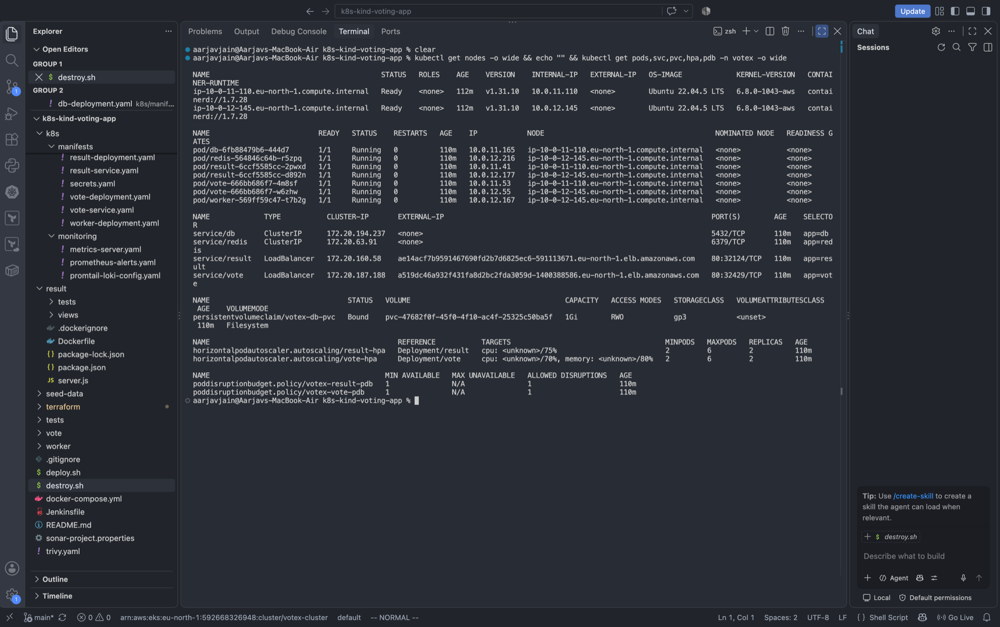
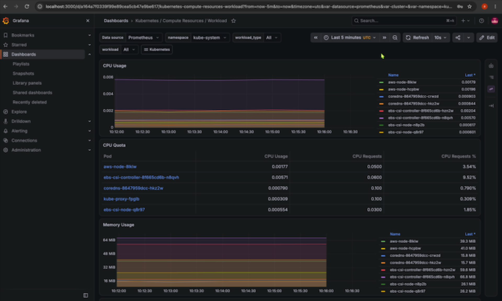
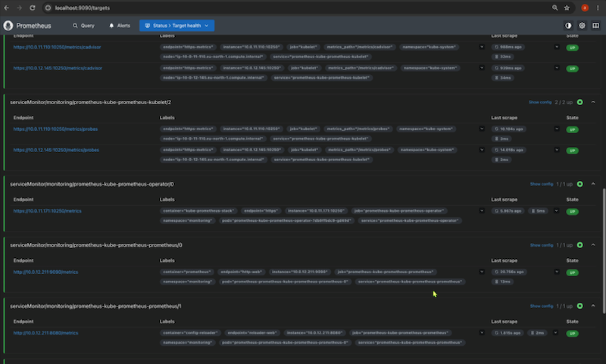

# Votex - Cloud-Native Distributed Microservices on AWS EKS

Votex is an enterprise 5-tier microservices polling and analytics platform provisioned on Amazon EKS using modular Terraform and Helm 3. It features end-to-end automation with Jenkins CI/CD, SonarQube static code analysis, Trivy vulnerability scanning, Prometheus/Grafana observability, zero-downtime rolling deployments, auto-healing workloads, and persistent PostgreSQL storage backed by AWS EBS gp3.

---

## Application Interfaces

The platform consists of a user-facing voting portal and a real-time analytics engine exposed via AWS Elastic Load Balancers:

| Vote Microservice (Python / Flask) | Result Analytics (Node.js / Socket.IO) |
| :---: | :---: |
|  |  |

---

## System Architecture & Data Flow

```
                      [ Client Traffic ]
                              │
                              ▼
                  [ AWS Elastic Load Balancers ]
                              │
            ┌─────────────────┴─────────────────┐
            ▼                                   ▼
      Vote Service                        Result Service
      (Python Flask)                   (Node.js + Socket.IO)
            │                                   ▲
            ▼ (XADD / Streams)                  │ (Real-time Broadcast)
     Redis Streams Queue                        │
            │                                   │
            ▼ (XREADGROUP / XAUTOCLAIM)         │
      Worker Service                            │
         (Python)                               │
            │                                   │
            ▼ (Idempotent UPSERT)               │
      PostgreSQL Database (AWS EBS gp3 PVC) ────┘
```

1. **Vote Ingestion**: Users cast votes through the Python Flask API with OpenTelemetry distributed trace context (`traceparent`).
2. **Buffering**: Incoming submissions are appended to an in-memory Redis stream (`votes_stream`) and persistent queue with consumer groups to handle high-concurrency traffic spikes.
3. **Async Processing**: A Python worker daemon continuously consumes votes via Redis Streams consumer groups (`XREADGROUP` / `XAUTOCLAIM`), preventing message loss during pod restarts, and commits idempotent transactions to PostgreSQL.
4. **Live Dashboard**: The Node.js service watches the database and broadcasts live voting tallies via WebSockets (Socket.IO).

---

## Automated CI/CD & DevSecOps Pipeline

Every code push to GitHub triggers an automated 9-stage declarative Jenkins pipeline executed directly inside the AWS EKS cluster:


### Pipeline Stages

1. **Checkout SCM**: Checks out source code repository and extracts release candidate metadata.
2. **Service Build & Smoke Validation**: Validates Python syntax, Node.js syntax, dependencies, and executes background service startup smoke checks against live processes.
3. **SonarQube Analysis & Quality Gate**: Performs static application security testing (SAST) and enforces strict quality gate thresholds.
4. **Trivy Filesystem Scan**: Scans repository filesystem and dependencies for `HIGH` and `CRITICAL` vulnerabilities with zero tolerance.
5. **Docker Build**: Builds deterministic, multi-stage `linux/amd64` container images for Vote, Result, Worker, and Seed data.
6. **Trivy Image Scan**: Scans built release candidate container images for critical CVE vulnerabilities before release.
7. **OWASP ZAP DAST**: Executes dynamic application security testing (DAST) baseline scans against candidate containers.
8. **Docker Hub Publish**: Authenticates and publishes verified release candidate images with immutable commit tags to Docker Hub (`aarjavjainn`).
9. **EKS Deployment & Verification**: Deploys Helm chart release with automatic rollback, checks rollout status, and runs Ansible health verification.

> [!NOTE]
> Detailed application test suites (`votex/tests/`, `votex/result/tests/`, `tests/`) are maintained locally on the developer workstation and untracked in Git. The CI pipeline executes self-contained syntax, import, and process smoke checks in Stage 2, ensuring fresh GitHub clones build cleanly without local test dependencies.
#### Vulnerability Scanning Demonstration (Full HD Walkthrough)

https://github.com/user-attachments/assets/2246317c-2834-4176-8a3f-2e7f67263f33

### Code Quality & Security (SonarQube)

Static application security testing (SAST) runs automatically against all microservices to enforce strict quality gates before deployment:

| Quality Gate Overview | Code Quality & Vulnerability Breakdown |
| :---: | :---: |
|  |  |

---

## AWS Cloud Infrastructure (Option B — eu-north-1)

All cloud infrastructure is provisioned through modular Terraform in `eu-north-1` (Stockholm):


- **Isolated Custom VPC (`10.0.0.0/16`)**:
  - **2 Public Subnets** (`10.0.1.0/24`, `10.0.2.0/24`): Host the NAT Gateway and public internet-facing AWS Load Balancers.
  - **2 Private Subnets** (`10.0.11.0/24`, `10.0.12.0/24`): Host EKS worker nodes and database storage with no direct public ingress.
- **EKS Managed Node Group (Option B)**: 2x `m7i-flex.large` compute instances (fixed size: 2 desired, 2 min, 2 max for strict cost control; providing 4 vCPU and 16 GiB total allocatable memory) with 20 GB gp3 encrypted root volumes across private subnets.
- **Elastic Load Balancing & Service Exposure**:
  - **Private-First Microservices**: Vote and Result services deploy as private `ClusterIP` services to prevent unauthenticated HTTP exposure over the public internet.
  - **Online HTTPS Architecture**: The platform prepares an AWS Application Load Balancer Ingress (`ingressClassName: alb`) with SSL redirect and port 443 host-based routing for Vote, Result, Jenkins, SonarQube, and Grafana when custom domain and ACM certificates are provisioned.
- **AWS EBS CSI Driver & gp3 StorageClass**: Dynamically provisions persistent AWS EBS gp3 volumes for PostgreSQL database, Redis persistence, Jenkins, and Prometheus with IAM Roles for Service Accounts (IRSA).
- **Kubernetes API Security**: EKS public API endpoint access is restricted to an approved operator CIDR allowlist (`cluster_endpoint_public_access_cidrs`) with internal worker communication routed via the private VPC endpoint.
- **Cost-Optimized NAT Gateway**: Single NAT Gateway deployed in public subnet 1 to provide outbound internet access for container pulls while keeping cloud costs minimal.
### AWS EKS Cluster Workloads & Deployment Status (Full HD Walkthrough)

https://github.com/user-attachments/assets/91521a43-0c8e-454e-b3b5-8c210cfe72e0

---

## Kubernetes Cluster Architecture & Resilience

Workloads are deployed using Helm charts with production-grade reliability configurations:



- **Zero-Downtime Rolling Updates**:
  Deployments use `RollingUpdate` with `maxSurge: 1` and `maxUnavailable: 0`. Kubernetes ensures a new replacement pod is healthy and passing readiness probes before terminating an old pod.
- **PreStop Hook & Graceful Draining**:
  A 5-second `preStop` hook drains in-flight HTTP requests and active transactions before container shutdown.
- **Auto-Healing Pods**:
  - **Liveness Probes**: Automatically restart hung or deadlocked containers.
  - **Readiness Probes**: Prevent traffic from reaching pods that are still initializing.
  - **PodDisruptionBudget (PDB)**: Guarantees at least 1 pod is always available during node maintenance or upgrades.
- **Horizontal Pod Autoscaling (HPA)**:
  Automatically scales microservices up to 6 replicas based on CPU and memory thresholds via Kubernetes Metrics Server.

---

## Observability & Monitoring

The monitoring stack collects infrastructure and container performance metrics:

| Grafana Cluster Resource Dashboard | Prometheus Targets & Scraping |
| :---: | :---: |
|  |  |

- **Prometheus**: Scrapes metrics from kubelet, cAdvisor, node-exporters, and application endpoints.
- **Grafana**: Visualizes real-time CPU, memory, network utilization, and cluster workload quotas.

### Cluster Workload Monitoring (Grafana Walkthrough)

https://github.com/user-attachments/assets/c9bc1c19-235d-40d0-875c-49dba38a6ade

### Prometheus Alerting Rules Evaluation

https://github.com/user-attachments/assets/23da52c0-1ce0-47f8-a20f-70f46419d60b

### Prometheus Target Scraping & Health

https://github.com/user-attachments/assets/a50e9eeb-beac-4204-ae8f-2126364a1e32

---

## Repository Structure

```
votex/
├── votex/                    # Core microservices, database, and developer tests
│   ├── vote/                 # Python Flask microservice (API, UI, auth, session cookies)
│   ├── result/               # Node.js Express & Socket.IO real-time analytics engine
│   ├── worker/               # Python worker daemon (Redis Streams + idempotent PostgreSQL)
│   ├── seed-data/            # Mock vote generator for stress and integration testing
│   ├── db/                   # PostgreSQL schema definitions and migrations (init.sql)
│   ├── healthchecks/         # Custom healthcheck scripts for database and cache
│   └── tests/                # Application unit, integration, and reliability test suites (local-only)
├── jenkins/                  # Declarative 9-stage CI/CD pipeline and agent pod specifications
├── sonarqube/                # SonarQube static analysis configuration and quality gates
├── docker/                   # Docker Compose multi-container development configuration
├── terraform/                # Infrastructure as Code (AWS EKS & VPC in eu-north-1)
│   ├── modules/
│   │   ├── vpc/              # Isolated VPC, 2 public & 2 private subnets, IGW, NAT GW
│   │   └── eks/              # EKS cluster, m7i-flex.large node group, IAM roles, EBS CSI IRSA
│   ├── scripts/
│   │   └── post_apply.sh     # Decoupled post-apply cluster bootstrap script
│   ├── main.tf               # Root module connecting VPC & EKS
│   ├── variables.tf          # Configurable variables (defaults to eu-north-1)
│   ├── outputs.tf            # Cluster endpoint & kubeconfig command
│   ├── versions.tf           # Terraform & AWS provider requirements
│   ├── terraform.tfvars      # Active configuration values (git-ignored)
│   └── README.md             # Terraform operations guide
├── k8s/                      # Kubernetes Helm charts & StorageClass resources
│   ├── helm/votex/           # Helm 3 chart (values.yaml & values-eks.yaml)
│   ├── manifests/            # Independent manifests (gp3-storageclass.yaml, namespace.yaml)
│   └── monitoring/           # Metrics server, Prometheus alert rules, Grafana values
├── ansible/                  # Ansible automated post-deployment verification playbook
├── lambda/                   # AWS Lambda synthetic health check verifier
├── security/                 # Trivy filesystem/container policy and OWASP ZAP configurations
├── tests/                    # End-to-end load (k6) and chaos resilience test suites (local-only)
├── ops/                      # Operational deployment, dashboard, and teardown scripts
│   ├── deploy.sh             # Infrastructure preflight plan script
│   ├── dashboard.sh          # Dynamic service endpoint and online status inspector
│   └── destroy.sh            # Safe teardown script with PVC purging & confirmation gate
└── docs/                     # Architectural diagrams, screenshots, and walkthrough assets
```

---

## Feature Status & Scope Classification (Option B)

To ensure production integrity and resource safety, the platform features are categorized as follows:

| Component / Feature | Implementation State | Verification Level | Scope Classification |
| :--- | :--- | :--- | :--- |
| **Vote Flask Microservice** | Complete | Locally Tested (51 pytest, 67% coverage) | **Option B (Active Core)** |
| **Worker Python Daemon** | Complete | Locally Tested (Integration tests) | **Option B (Active Core)** |
| **Result Node.js Microservice** | Complete | Locally Tested (10 Node tests) | **Option B (Active Core)** |
| **PostgreSQL & Redis Streams** | Complete | Locally Tested (Docker Compose & Helm) | **Option B (Active Core)** |
| **OpenTelemetry / X-Ray Collector**| Complete | Configured in Helm & Local Compose | **Option B (Active Core)** |
| **Terraform VPC & EKS (eu-north-1)** | Complete | Planned (33 add, 0 chg, 0 del) | **Option B (Cloud Infra)** |
| **EBS gp3 Dynamic CSI (IRSA)** | Complete | Validated via Helm / Terraform | **Option B (Cloud Infra)** |
| **Kubernetes API CIDR Allowlist** | Complete | Configured in `terraform.tfvars` | **Option B (Cloud Infra)** |
| **Ansible Post-Deployment Verification** | Complete | Syntax-checked & Playbook ready | **Option B (Post-Deploy)** |
| **AWS Lambda Synthetic Health Check** | Complete | Tested locally & Packaged | **Option B (Post-Deploy)** |
| **Jenkins 9-Stage Declarative Pipeline** | Complete | Configured in `jenkins/Jenkinsfile` | **Option B (CI/CD)** |
| **SonarQube SAST & Quality Gate** | Complete | Configured in `sonarqube/` | **Option B (DevSecOps)** |
| **Prometheus & Grafana Observability**| Complete | Dashboards, alert rules, & values ready | **Option B (Observability)** |

> [!NOTE]
> Under **Option B**, the cluster utilizes 2x `m7i-flex.large` compute instances (4 vCPU, 16 GiB allocatable RAM), providing the memory capacity required for core microservices, CI/CD agents, and monitoring tools. Workloads are scheduled with explicit resource limits and pod anti-affinity to ensure rock-solid stability.

---

## Deployment & Operations

### 1. Preflight Infrastructure Planning

Generate and review the Terraform execution plan from the repository root:
```bash
./ops/deploy.sh
```
This runs `terraform init`, `terraform validate`, and outputs an execution plan to `terraform/tfplan`.
Apply the plan only after explicit review:
```bash
cd terraform && terraform apply tfplan && cd ..
```

### 2. Post-Apply Cluster Bootstrap

Run the post-apply bootstrap script to configure local kubeconfig, verify worker nodes, register the AWS EBS CSI driver and `gp3` StorageClass, create namespace `votex`, bootstrap `db-secret` (containing exact keys `POSTGRES_USER`, `POSTGRES_PASSWORD`, `POSTGRES_DB`), and record OpenTelemetry IRSA parameters:
```bash
bash terraform/scripts/post_apply.sh
```

> [!NOTE]
> `post_apply.sh` safely verifies whether `db-secret` exists. If missing, it generates a cryptographically random password piped directly via `/dev/stdin` without revealing secrets in console logs, process arguments, or Git. If already present, existing credentials are fully preserved.

### 3. Build and Publish Application Images (linux/amd64)

Build and publish immutable, version-tagged `linux/amd64` images to Docker Hub before the initial Helm rollout:
```bash
docker build --platform linux/amd64 -t aarjavjainn/votex-vote:v2.0.0 ./votex/vote
docker build --platform linux/amd64 -t aarjavjainn/votex-result:v2.0.0 ./votex/result
docker build --platform linux/amd64 -t aarjavjainn/votex-worker:v2.0.0 ./votex/worker

docker push aarjavjainn/votex-vote:v2.0.0
docker push aarjavjainn/votex-result:v2.0.0
docker push aarjavjainn/votex-worker:v2.0.0
```

### 4. Deploy Votex Core Microservices via Helm (Option B)

Deploy core workloads using pinned `v2.0.0` container tags and the OpenTelemetry IAM role:
```bash
OTEL_ROLE=$(terraform -chdir=terraform output -raw otel_collector_role_arn)
helm upgrade --install votex ./k8s/helm/votex \
  -f ./k8s/helm/votex/values-eks.yaml \
  --set otel.collector.serviceAccount.roleArn="${OTEL_ROLE}" \
  --namespace votex
```

### 5. Inspect Service Endpoints & Online HTTPS Readiness

To display active service endpoints and ingress status:
```bash
./ops/dashboard.sh
```

Under Option B:
- **Private Microservice Endpoints**: In the initial private phase, Vote and Result services run as private `ClusterIP` (Service port `80`) to eliminate unauthenticated HTTP exposure over the public internet.
- **Online HTTPS Access**: When a custom domain and ACM certificate ARN are provisioned, enable the AWS Application Load Balancer Ingress (`--set ingress.enabled=true --set ingress.className=alb`) with host-based TLS routing on port 443.

### 6. Post-Deployment Verification via Ansible

Verify internal cluster health across application microservices using Ansible:
```bash
ansible-playbook ansible/verify_deployment.yml \
  -e "k8s_namespace=votex vote_endpoint=http://vote.votex.svc.cluster.local result_endpoint=http://result.votex.svc.cluster.local"
```

### 7. Automated Teardown & Cost Elimination

To safely uninstall all workloads, purge persistent EBS storage volumes, and destroy cloud infrastructure:
```bash
./ops/destroy.sh
```
The teardown script automatically uninstalls Helm releases, removes persistent volume claims (`votex-db-pvc`, `votex-redis-pvc`), plans the Terraform destroy, requires explicit confirmation (`confirm-terraform-destroy`), and audits remaining AWS resources to ensure zero lingering costs.

---

## Author & Maintainer

Developed by **[Aarjav Jain](https://github.com/itsme-aarjav)**.
